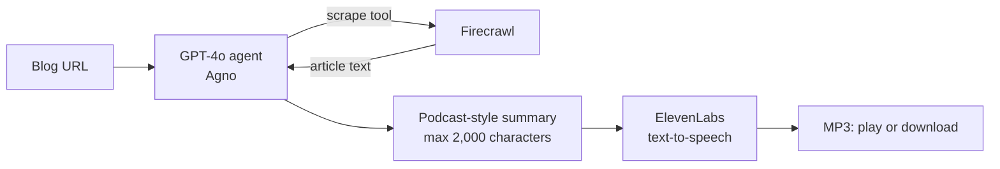

# 📰 ➡️ 🎙️ Blog-to-Podcast Agent

Paste a blog URL and get a narrated podcast episode in a few minutes — ready to play in the browser or download as MP3.

## How it works



1. **Scrape** – an AI agent (GPT-4o, built with [Agno](https://github.com/agno-agi/agno)) uses Firecrawl as a tool to read the article.
2. **Summarize** – the agent writes a short, conversational summary that sounds natural when spoken.
3. **Narrate** – ElevenLabs turns the summary into speech.
4. **Listen** – the episode plays in the app, with a download button and the written summary below.

What used to take hours of recording and editing now takes **under 3 minutes**.

## Tech stack
Python · Agno · OpenAI GPT-4o · Firecrawl · ElevenLabs · Streamlit

## Run it locally

```bash
git clone https://github.com/Harshamaringanti48/blog-to-podcast-agent.git
cd blog-to-podcast-agent
pip install -r requirements.txt
streamlit run blog_to_podcast_agent.py
```

You'll need API keys for OpenAI, Firecrawl and ElevenLabs — enter them in the sidebar.

## What I learned
- The hard part wasn't text-to-speech — it was chaining scraping, summarizing and audio into one reliable pipeline.
- Writing *for the ear* is different from writing to read: the prompt asks for a conversational tone and a length limit so episodes stay short and natural.

## Next steps
- Choice of voices and episode length
- Two-host "conversation" format
